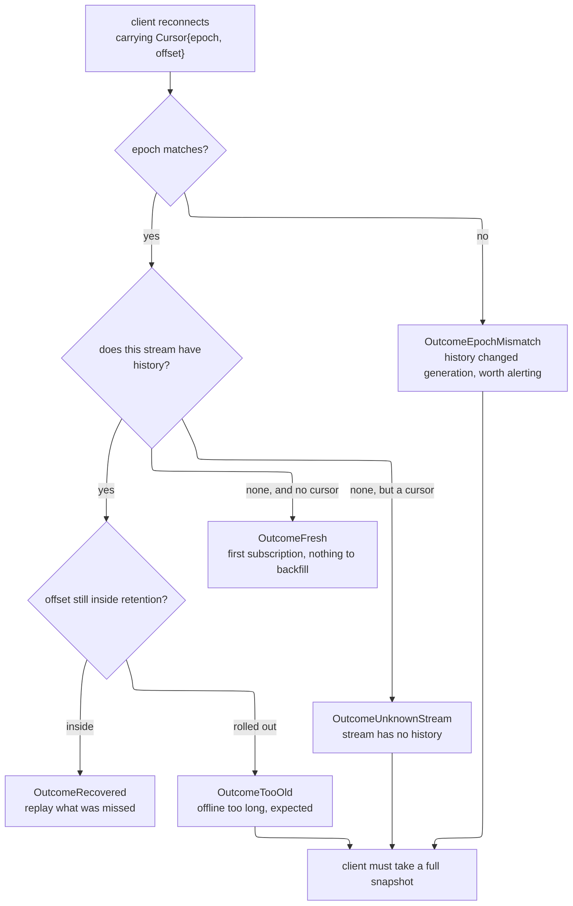

# Go Replay (go-replay) 🔁

[](https://opensource.org/licenses/MIT)
[](https://github.com/kamalyes/go-replay)
[](https://github.com/kamalyes/go-replay/releases)
[](https://goreportcard.com/report/github.com/kamalyes/go-replay)
[](https://pkg.go.dev/github.com/kamalyes/go-replay?tab=doc)
[](https://github.com/kamalyes/go-replay/issues)
[](https://github.com/kamalyes/go-replay/stargazers)

**English** · **[简体中文](README_ZH.md)**

**go-replay** gives you resumable message streams addressed by position: after a client
reconnects it learns which messages it missed, how to backfill them, and — the part that
matters most — **when backfilling is no longer possible**

**Zero third-party dependencies** (`go.mod` contains not one `require`)

---

## 🎯 The third question is the one most hand-rolled designs omit

| Question | A hand-rolled design usually | Consequence |
|---|---|---|
| Which messages did I miss | keeps an offset | ✅ handled |
| How do I backfill them | reads from after the offset | ✅ handled |
| **When can I no longer backfill** | **not handled** | ❌ **the client diverges in silence** |

Here is the failure that omission produces. The history buffer itself can be lost — the store
restarts, a node is replaced, the buffer is flushed — and a client comes back holding
`offset=1000` while the server's history is empty:

```
"nothing new after 1000"        ← what the server answers
"everything after 1000 is gone" ← what is actually true
```

**The two are indistinguishable at the interface.** The client believes it is current while it
has permanently diverged, and it will never heal on its own. The symptom reads as occasional
data inconsistency, which is close to impossible to attribute

---

## 🔑 The epoch is the only thing that separates those two cases

Give every stream a generation number and change it whenever the buffer is rebuilt. An `epoch`
a client brings back that no longer matches the current one means the history is discontinuous



---

## 🎚️ Recovery answers with five outcomes rather than a bool

```go
OutcomeRecovered      // resumed
OutcomeFresh          // first subscription, nothing to backfill
OutcomeTooOld         // cursor rolled out of the window  ← expected, the client was away
OutcomeEpochMismatch  // generation differs               ← worth alerting, the store changed
OutcomeUnknownStream  // the stream has no history
```

A bool collapses "the client was offline too long" and "the store changed generation" into one
value. The first is routine and the second deserves an alert, yet monitoring could not tell
them apart

```go
if outcome.NeedsResync() {
    metrics.Inc("resync", outcome.String())   // too_old and epoch_mismatch counted separately
    sendFullSnapshot(conn)
}
```

**A hard rule**: when `NeedsResync()` is true, `records` is always empty. Returning "some
messages plus you need a resync" invites the caller to treat those messages as a complete
increment

---

## ♻️ Retention bounds by count and by age, whichever comes first

| Count alone | Age alone |
|---|---|
| A cold stream carrying a few messages a day keeps months-old records, and a client "recovers successfully" into a batch of long-irrelevant messages | A hot stream at thousands a second piles an astronomical number into the window and memory runs away |

Bounding by **whichever comes first** is the same approach as Kafka's `retention.bytes` plus
`retention.ms`, and Redis Streams' `MAXLEN` plus `MINID`

```go
store := replay.NewMemoryStore(replay.Config{
    MaxPerStream: 512,              // at most 512 records per stream
    MaxAge:       10 * time.Minute, // and no older than ten minutes
})
```

---

## 📐 The shape is not invented here

| Reference implementation | What it does |
|---|---|
| **Centrifugo recovery** | per-channel `offset` plus `epoch`, replay inside the window, an explicit failure when it cannot |
| **Redis Streams consumer groups** | `XADD` assigns an id, `XREADGROUP` reads from a position, the PEL tracks what is unacknowledged |
| **NATS JetStream** durable consumer | a position, a replayable log and acks |
| **Kafka** consumer offset | a position and a retention policy |

This library distils that common shape into **a port of two methods**, with a dependency-free
in-memory implementation as the reference semantics

---

## 📦 Install

```bash
go get github.com/kamalyes/go-replay
```

---

## 🚀 Quick start

### The write side

```go
store := replay.NewMemoryStore(replay.Config{
    MaxPerStream: 256,
    MaxAge:       5 * time.Minute,
    // Leaving Epoch empty derives it from the start time, so a process restart changes
    // generation by itself and the caller need not remember to. Forgetting would let a
    // client resume from a cursor belonging to the previous generation
})

cur, err := store.Append(ctx, "room-42", payload)
// cur.String() reads like "m20230612175119.000000000:17" and goes straight to the client
```

### The reconnect side

```go
// A cursor from a client is untrusted input: a malformed value degrades to the zero value
// rather than an error, which sends that client to a full resync instead of refusing it
cur := replay.ParseCursor(handshake.Cursor)

recs, outcome, err := store.Since(ctx, "room-42", cur, 200)
if err != nil {
    return err
}
switch {
case outcome.NeedsResync():
    // too_old, epoch_mismatch or unknown_stream
    sendFullSnapshot(conn, outcome)
default:
    for _, r := range recs {
        sendIncremental(conn, r.Offset, r.Payload)
    }
}
```

### Taking a baseline on first subscription

```go
if cur, ok := store.Latest("room-42"); ok {
    // start incrementally from here without backfilling history
}
```

---

## 🧩 Ports

| Port | Methods | Responsibility |
|---|---|---|
| `Appender` | 1 | `Append` adds a record and returns its position |
| `Resumer` | 1 | `Since` reads from a position and reports the recovery outcome |
| `Store` | 2 | both halves together, convenient for a single implementation |

Reads and writes are separate so that a read-only replica need implement only half: replaying
history is read-heavy and write-light, and replicas commonly carry it

An adapter over Redis Streams or JetStream implements one or two methods

---

## ⚠️ Two things that are easy to get wrong

### A process restart has to change the epoch

`NewMemoryStore` derives `Config.Epoch` from the start time when it is left empty, which is the
safe default. **Pinning it to a constant means that after a restart a client resumes from a
cursor belonging to the previous generation while the in-memory history is already empty** — it
then receives "recovered successfully, zero messages" and diverges in silence

### Evicting the record at the cursor is not a gap

A client whose cursor is `offset=5` wants `offset=6`. Evicting `offset=5` does not affect it,
**because it already received that record**. A genuine gap is when records after the cursor
were evicted too

`TestEvictingTheCursorRecordIsNotAGap` pins this semantic down so nobody loosens the check
later

---

## 🧱 Non-goals

- **No transport.** This library owns positions and history; how a message reaches a client is the caller's decision
- **No guarantee against loss.** Messages outside the window are genuinely gone, and what is guaranteed is that **you will know**
- **No deduplication.** Duplicates under at-least-once delivery are the caller's to handle with a business idempotency key
- **No cross-stream transactions.** Each stream is independent, with no ordering or atomicity across them

---

## 🧪 Quality

| Item | Value |
|---|---|
| Statement coverage | **95.8%** |
| Mutation checks | removing the generation comparison, the out-of-window test, the payload copy or age-based eviction — **all five were caught by tests** |
| Concurrency | `-race -shuffle=on` green |
| Dependencies | not one `require` in `go.mod` |

---

## 🤝 Community and support

- Questions and suggestions: [GitHub Issues](https://github.com/kamalyes/go-replay/issues)
- Related: [go-wsc](https://github.com/kamalyes/go-wsc) · [go-toolbox](https://github.com/kamalyes/go-toolbox)

---

## 📄 License

MIT License, see [LICENSE](LICENSE)

---

## 📌 Commit emoji legend

| Emoji | Type | Meaning |
|---|---|---|
| ✨ | feat | a new capability |
| 🐛 | fix | a defect repaired |
| ⚡ | perf | a performance change |
| ♻️ | refactor | restructuring |
| 📝 | docs | documentation |
| ✅ | test | tests |
| 🔧 | ci | build and pipeline |
| 📦 | deps | dependencies |
