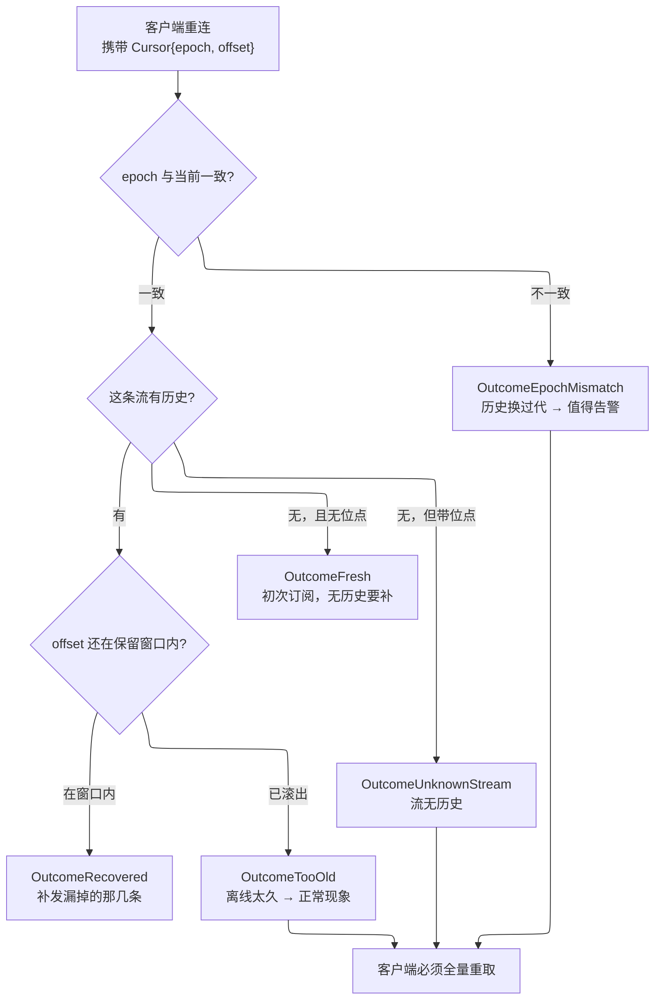

# Go Replay (go-replay) 🔁

[](https://opensource.org/licenses/MIT)
[](https://github.com/kamalyes/go-replay)
[](https://github.com/kamalyes/go-replay/releases)
[](https://goreportcard.com/report/github.com/kamalyes/go-replay)
[](https://pkg.go.dev/github.com/kamalyes/go-replay?tab=doc)
[](https://github.com/kamalyes/go-replay/issues)
[](https://github.com/kamalyes/go-replay/stargazers)

**[English](README.md)** · **简体中文**

**go-replay** 是按位点重放的可恢复消息流:客户端断线重连后,知道自己漏了哪些、怎么补回来,以及——最关键的——**什么时候补不回来了**

**零三方依赖**(`go.mod` 没有一条 `require`)

---

## 🎯 它解决的第三个问题,是多数自制方案漏掉的那个

| 问题 | 自制方案通常 | 后果 |
|---|---|---|
| 我漏了哪些消息 | 记一个 offset | ✅ 能做 |
| 怎么把它们补回来 | 从 offset 之后读 | ✅ 能做 |
| **我什么时候补不回来了** | **没处理** | ❌ **客户端静默偏离** |

第三点漏掉之后的故障长这样:历史缓冲自身丢了(存储重启、节点换人、缓冲被清空),客户端带着 `offset=1000` 回来,而服务端历史是空的 —— 于是

```
"1000 之后没有新消息"   ← 服务端这么回
"1000 之后的消息全丢了"  ← 实际是这个
```

**两者在接口上长得一模一样** 客户端认为自己是最新的,实际已永久偏离,且永远不会自愈 故障表现是"偶发数据不一致",极难归因

---

## 🔑 epoch:唯一能分开这两种情况的东西

给每条流一个世代号,缓冲重建时换新值 客户端带回的 `epoch` 与当前不符,就说明历史不连续



---

## 🎚️ 恢复结论用五态,不用 bool

```go
OutcomeRecovered      // 续传成功
OutcomeFresh          // 初次订阅，无历史要补
OutcomeTooOld         // 位点滚出窗口   ← 正常现象，客户端离线太久
OutcomeEpochMismatch  // 世代不符       ← 值得告警，存储换过代
OutcomeUnknownStream  // 流无历史
```

用 bool 会把「客户端离线太久」和「存储换过代」压成同一个值 —— 前者是常态、后者该告警,监控里却分不开

```go
if outcome.NeedsResync() {
    metrics.Inc("resync", outcome.String())   // too_old 与 epoch_mismatch 分开计数
    sendFullSnapshot(conn)
}
```

**硬约定**:`NeedsResync()` 为真时 `records` 必须为空 —— 返回「部分消息 + 需重取」会诱导调用方把那部分当成完整增量

---

## ♻️ 保留策略按条数与时长取先到者

| 只按条数 | 只按时长 |
|---|---|
| 冷流(每天几条)会留着几个月前的消息,客户端「恢复成功」地收到一批早已无意义的东西 | 热流(每秒上千条)在窗口内堆出天文数字,内存失控 |

两者取**先到者**,与 Kafka 的 `retention.bytes` + `retention.ms`、Redis Streams 的 `MAXLEN` + `MINID` 同一思路

```go
store := replay.NewMemoryStore(replay.Config{
    MaxPerStream: 512,              // 每条流最多 512 条
    MaxAge:       10 * time.Minute, // 且不超过 10 分钟
})
```

---

## 📐 形状不是自创

| 参照实现 | 它的做法 |
|---|---|
| **Centrifugo recovery** | 每频道 `offset` + `epoch`,窗口内补发,补不上明确报失败 |
| **Redis Streams 消费组** | `XADD` 分配 ID、`XREADGROUP` 按位点读、PEL 跟未确认 |
| **NATS JetStream** durable consumer | 位点 + 可重放日志 + ack |
| **Kafka** consumer offset | 位点 + 保留策略 |

本库把这个共同形状抽成**两个方法的端口**,并给一个零依赖的内存实现作为参照语义

---

## 📦 安装

```bash
go get github.com/kamalyes/go-replay
```

---

## 🚀 快速开始

### 写入侧

```go
store := replay.NewMemoryStore(replay.Config{
    MaxPerStream: 256,
    MaxAge:       5 * time.Minute,
    // Epoch 留空时按启动时间生成，于是进程重启自然换代，
    // 不必调用方记得去改 —— 忘了改就会让客户端拿着上一世的位点来续传
})

cur, err := store.Append(ctx, "room-42", payload)
// cur.String() 形如 "m20230612175119.000000000:17"，直接随消息下发给客户端
```

### 重连侧

```go
// 客户端送来的位点是不可信输入：畸形值退化成零值而不是报错，
// 让它走全量重取，而不是直接拒掉连接
cur := replay.ParseCursor(handshake.Cursor)

recs, outcome, err := store.Since(ctx, "room-42", cur, 200)
if err != nil {
    return err
}
switch {
case outcome.NeedsResync():
    // too_old / epoch_mismatch / unknown_stream
    sendFullSnapshot(conn, outcome)
default:
    for _, r := range recs {
        sendIncremental(conn, r.Offset, r.Payload)
    }
}
```

### 首订取基准

```go
if cur, ok := store.Latest("room-42"); ok {
    // 从这里开始增量，不补历史
}
```

---

## 🧩 端口

| 端口 | 方法数 | 职责 |
|---|---|---|
| `Appender` | 1 | `Append` 追加并返回位点 |
| `Resumer` | 1 | `Since` 按位点读并给出恢复结论 |
| `Store` | 2 | 读写合一,便于单实现装配 |

读写分开,是为了让只读副本只实现一半 —— 补发历史是读多写少的操作,常常由副本承担

写一个 Redis Streams 或 JetStream 适配器只需实现一到两个方法

---

## ⚠️ 两条容易踩的

### 进程重启必须换 epoch

`Config.Epoch` 留空时由 `NewMemoryStore` 按启动时间生成,这是默认的安全行为 **如果你显式写死一个常量 epoch,重启后客户端会拿着上一世的位点来续传,而内存历史早已空了** —— 于是收到「恢复成功 + 零条消息」,静默偏离

### 位点那条被淘汰不构成缺口

客户端位点是 `offset=5`,它要的是 `offset=6` 淘汰掉 `offset=5` 不影响它,**因为它已经收到过那条了** 真正的缺口是「位点之后的消息也被淘汰了」

这条语义有专门的对照测试钉住(`TestEvictingTheCursorRecordIsNotAGap`),免得日后有人把判定改松

---

## 🧱 非目标

- **不提供传输** 本库只管位点与历史,消息怎么送到客户端由调用方决定(可配 [go-sluice](https://github.com/kamalyes/go-sluice))
- **不保证消息不丢** 窗口之外的消息就是丢了 本库保证的是**你会知道它丢了**
- **不做去重** 至少一次投递下的重复由调用方按业务幂等键处理
- **不做跨流事务** 每条流各自独立,没有跨流的顺序或原子性保证

---

## 🧪 质量

| 项 | 值 |
|---|---|
| 语句覆盖率 | **95.8%** |
| 变异测试 | 撤掉世代比对 / 滚出窗口判定 / 载荷复制 / 按时长淘汰 —— **五处全被测试抓住** |
| 并发 | `-race -shuffle=on` 全绿 |
| 依赖 | `go.mod` 零 `require` |

---

## 🤝 社区与支持

- 问题与建议:[GitHub Issues](https://github.com/kamalyes/go-replay/issues)
- 相关库:[go-sluice](https://github.com/kamalyes/go-sluice) 消息分发内核 · [go-wsc](https://github.com/kamalyes/go-wsc) · [go-toolbox](https://github.com/kamalyes/go-toolbox)

---

## 📄 许可证

MIT License,详见 [LICENSE](LICENSE)

---

## 📌 Commit Emoji 图例

| Emoji | 类型 | 含义 |
|---|---|---|
| ✨ | feat | 新功能 |
| 🐛 | fix | 修缺陷 |
| ⚡ | perf | 性能优化 |
| ♻️ | refactor | 重构 |
| 📝 | docs | 文档 |
| ✅ | test | 测试 |
| 🔧 | ci | 构建与流水线 |
| 📦 | deps | 依赖 |
